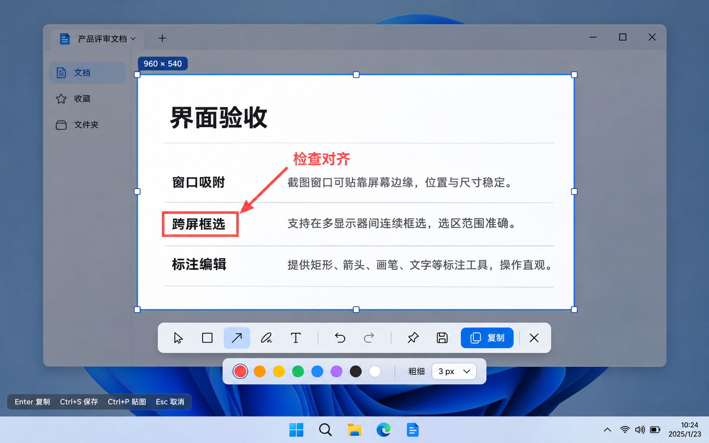
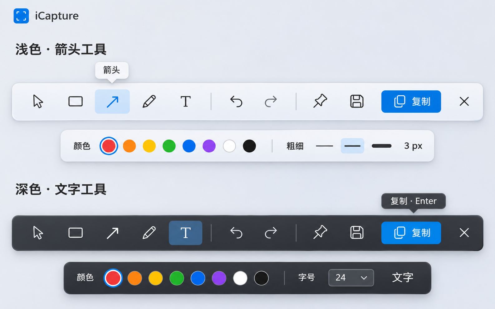
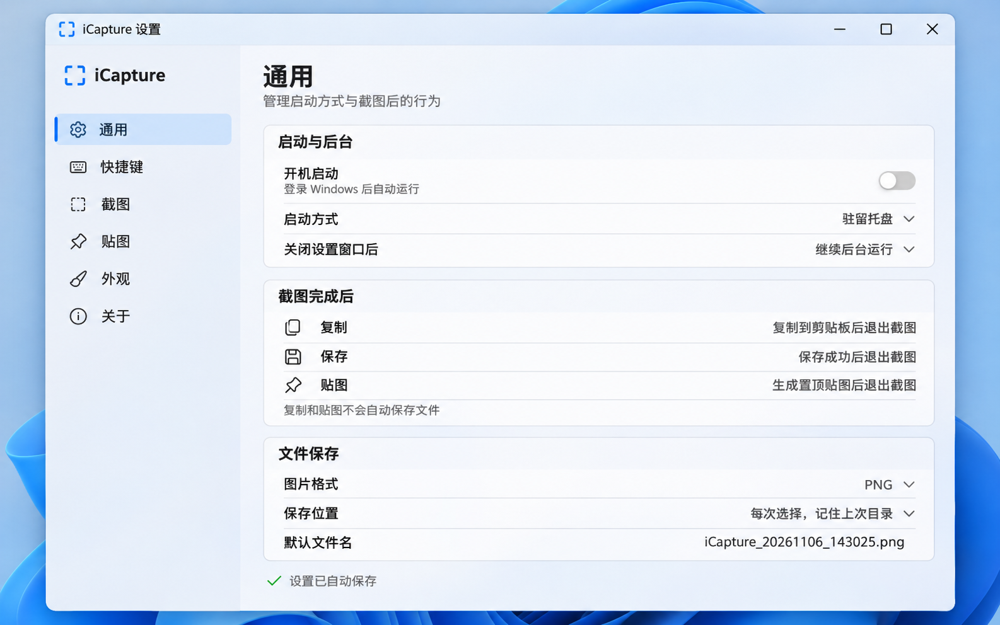
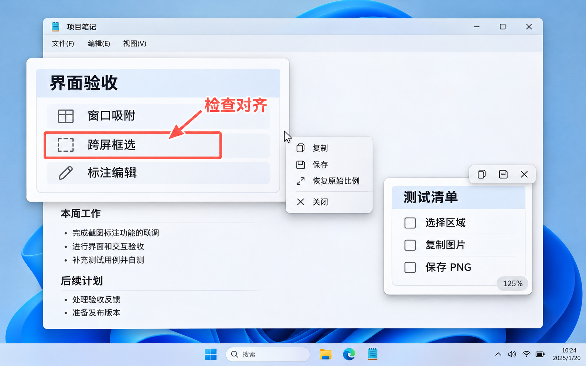

# iCapture

面向 Windows 11 的轻量截图、标注与置顶贴图工具。使用 Rust 原生实现，优先控制体积、响应速度与后台资源占用。

当前状态：已建立 Rust 原生 Windows 工程，正在 P1 工程与风险验证阶段。当前程序提供托盘、热键、WGC 桌面捕获及 Direct2D 诊断预览，尚不是完整截图编辑器，不作为 v0.1.0 成品分发。

## 开发与验证

需要 Windows 11 x64、MSVC Build Tools 和 Windows SDK。固定 Rust 1.88.0，Cargo 会读取仓库内工具链与目标配置。

```powershell
cargo fmt --all -- --check
cargo clippy --workspace --all-targets -- -D warnings
cargo test --workspace
cargo build --release
```

构建结果为 `target/x86_64-pc-windows-msvc/release/icapture.exe`。运行后驻留托盘，Ctrl+Alt+A 或托盘开始截图可打开冻结桌面的诊断预览；关闭预览仍保留托盘。`--capture` 可在首次启动时直接开始捕获。

开发探针：`icapture.exe --probe artifacts/p1` 写入真实桌面 PNG 与捕获耗时；`icapture.exe --stress artifacts/p1/stress` 执行 100 次捕获、释放及资源采样。仅显式调用时运行，结果目录不入库。探针会包含真实屏幕内容，请勿将其作为公开测试数据提交。

当前验证结果和缺项见 [P1 验证报告](docs/validation/P1.md)。最终标注、输出操作、贴图、设置、主题及 ZIP 交付尚待后续阶段。

## 新会话执行入口

请先阅读 [AGENTS.md](AGENTS.md)，然后按 [实施计划](docs/IMPLEMENTATION_PLAN.md) 开始工作。

- [产品规格](docs/PRODUCT_SPEC.md)
- [设计规格](docs/DESIGN_SPEC.md)
- [实施计划](docs/IMPLEMENTATION_PLAN.md)
- [进度与交接记录](docs/PROGRESS.md)
- [设计参考说明](docs/design/README.md)

## 已确认范围

- 区域、窗口、全屏和跨显示器截图，兼容混合缩放。
- 矩形、箭头、画笔、文字，可编辑标注，撤销与重做。
- 独立的复制、PNG 保存和置顶贴图。
- 多张贴图的拖动、缩放、复制、保存和关闭。
- 默认 Ctrl+Alt+A，全局热键冲突提示，托盘与设置窗口。
- Win11 圆角半透明外观，跟随系统或手动选择深浅色。
- Windows 11 x64 ZIP 免安装首版；后续保留接入 macOS 的结构。

## 设计稿









本仓库中的设计稿由内置图像生成工具制作，用户已认可整体方向。真实控件行为以产品及设计规格为准。
