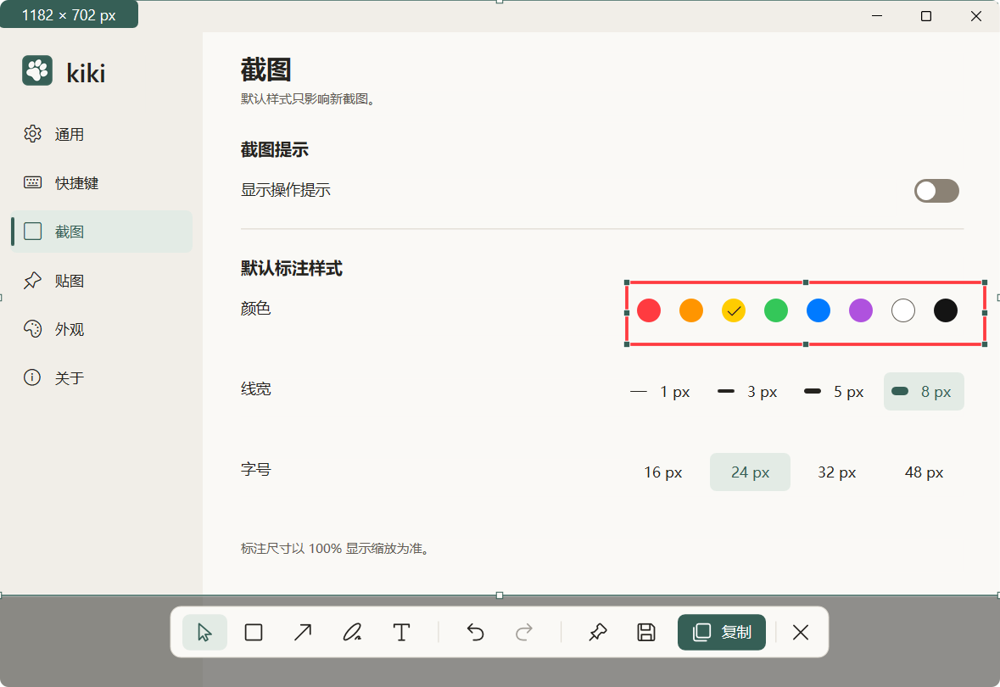
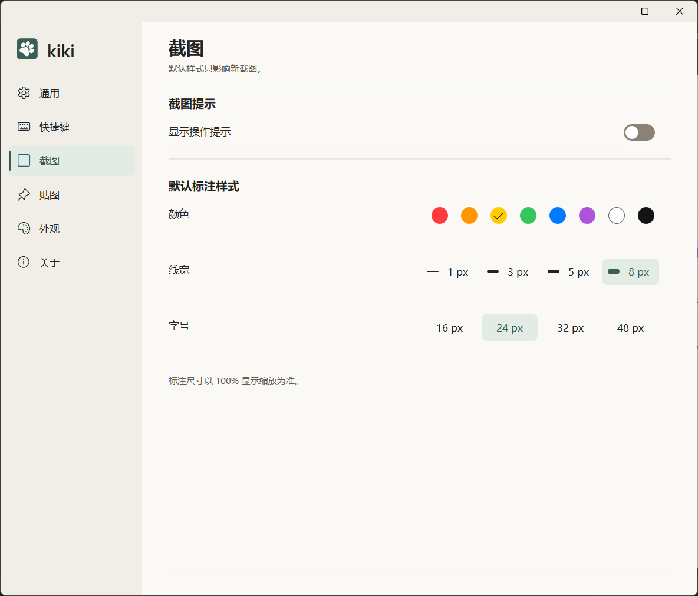
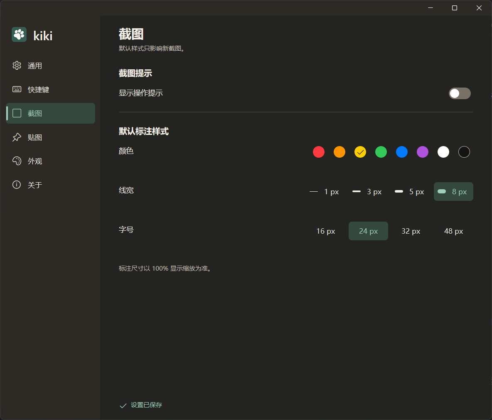

# kiki

轻量的 Windows 11 截图、标注与置顶贴图工具。使用 Rust 和 Windows 原生图形能力实现，解压即可运行。



## 功能

- 区域、窗口和当前屏幕截图。
- 矩形、箭头、画笔和文字标注；支持编辑、文字旋转、撤销与重做。
- 复制图像、保存 PNG，或生成可拖动、缩放的置顶贴图。
- 全局快捷键、托盘入口、自动保存设置，以及跟随系统的深浅主题。

当前本地版本为 **v0.6.1**，面向 **Windows 11 x64**。截图时可用滑杆、数值框或滚轮调整线宽与字号。可在截图设置中调整输出圆角，PNG 保留透明角。跨屏、混合 DPI 和 HDR 的验证状态见[当前进度](docs/PROGRESS.md)。

## 下载与使用

从 [Releases](https://github.com/Real-Bruce/kiki/releases) 下载 ZIP，解压后运行 `kiki.exe`，无需安装 Rust 或开发工具。

1. 首次启动点击「开始截图」，之后使用 **Ctrl+Alt+A** 或托盘菜单。
2. 拖动选择区域，使用工具条添加标注。
3. 按 **Enter** 复制、**Ctrl+S** 保存、**Ctrl+P** 贴图，或 **Esc** 取消。

贴图支持拖动、滚轮缩放、Ctrl+0 恢复原比例和 Esc 关闭。复制与贴图不会自动保存文件。

[完整使用说明](docs/USAGE.md) · [版本变更](docs/CHANGELOG.md)

## 界面

以下为用户提供的软件实际运行截图，采用暖灰与松绿主题。





截图环境与采集方式见[截图说明](docs/screenshots/README.md)。

## 开发

需要 Windows 11 x64、MSVC Build Tools、Windows SDK 和 PowerShell 7。仓库固定 Rust 1.88.0、2024 edition。

```powershell
cargo fmt --all -- --check
cargo clippy --workspace --all-targets --all-features --locked -- -D warnings
cargo test --workspace --locked
cargo test --workspace --all-features --locked
cargo build --release --locked
```

程序输出到 `target/x86_64-pc-windows-msvc/release/kiki.exe`。生成免安装包：

```powershell
./scripts/Package-Windows.ps1
```

[开发与诊断](docs/DEVELOPMENT.md) · [打包与发布](docs/RELEASING.md) · [文档索引](docs/README.md)

## 参与开发

提交问题时请说明系统版本、屏幕分辨率与缩放、复现步骤及预期结果。修改前阅读 [AGENTS.md](AGENTS.md)，保持原生 Rust 技术栈及既定范围；界面变更应附真实运行截图。

## 第三方许可

依赖许可随程序提供，也可在「关于」页离线查看。来源见[第三方许可说明](docs/THIRD_PARTY_LICENSES.md)。仓库尚未声明项目源码的开源许可证。
