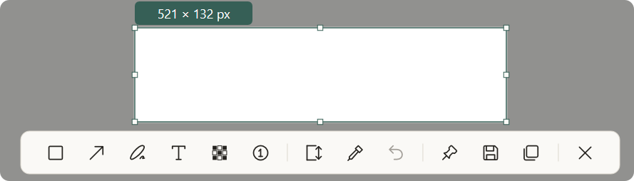
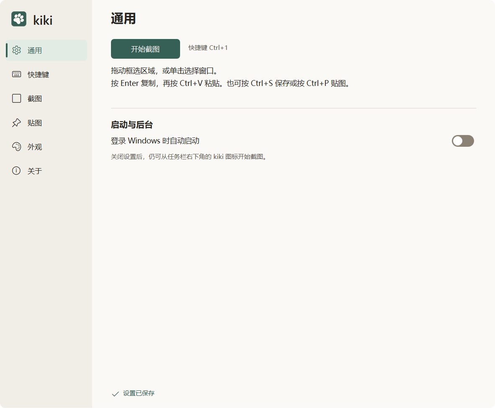
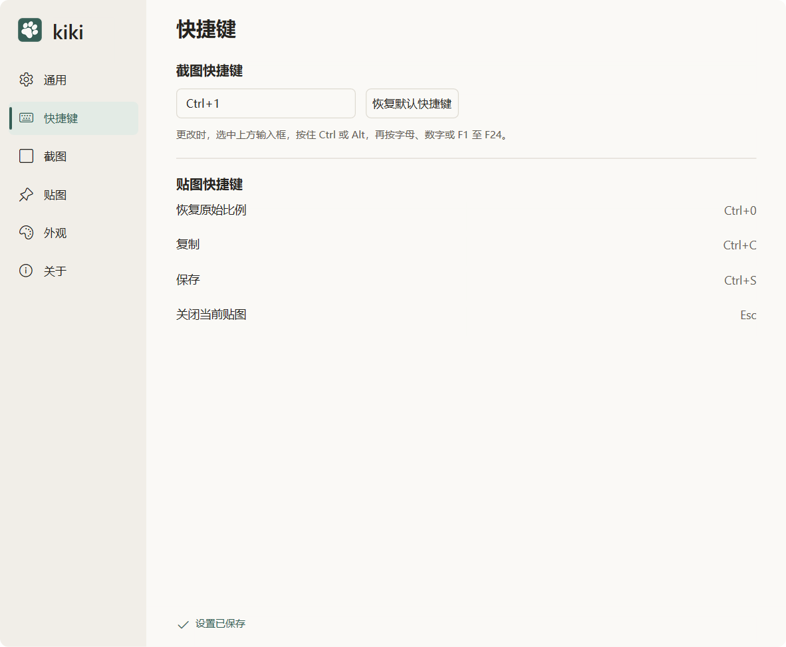
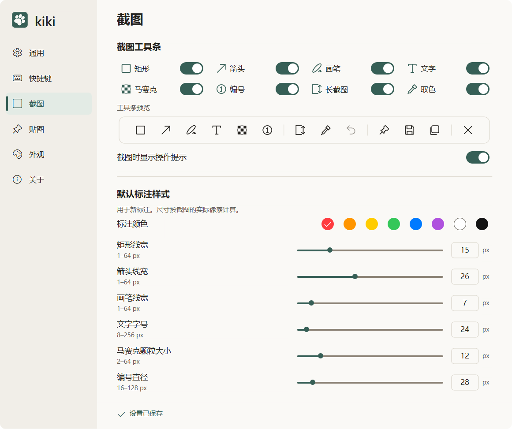
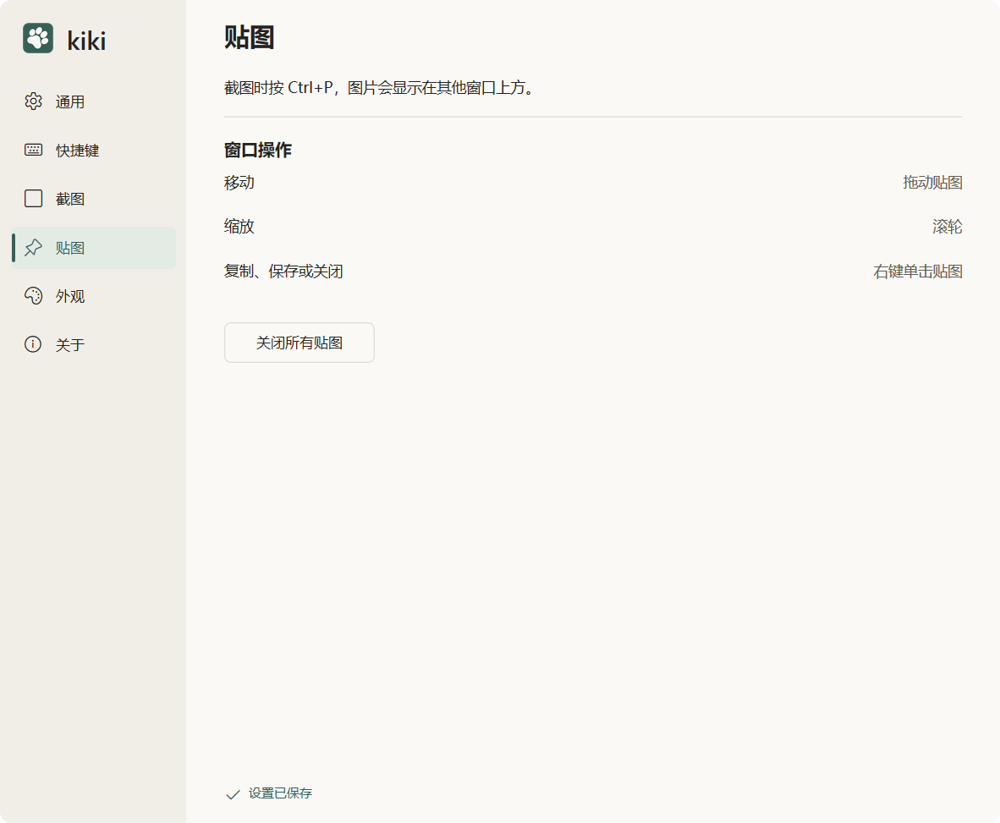
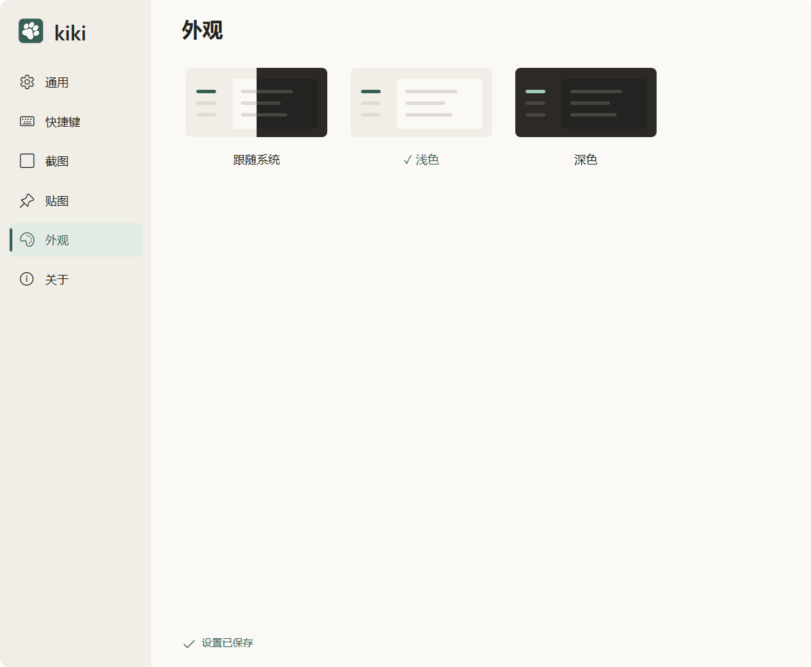

# kiki

轻量的 **Windows 11 x64** 原生截图、标注与置顶贴图工具。框选画面、添加标注，再复制、保存或贴在其他窗口上方。使用 Rust 与 Windows 原生图形能力实现，解压即可运行。

[English](README.md) · **简体中文**

[下载](https://github.com/Real-Bruce/kiki/releases) · [界面截图](#界面截图) · [文档索引](docs/README.md) · [版本变更](docs/CHANGELOG.md)



## 功能

- **截图：**区域、可见窗口和当前屏幕截图。
- **标注：**可编辑的矩形、箭头、画笔、文字、马赛克及顺序编号，支持撤销与重做，文字可移动和旋转。
- **取色：**读取冻结图像原始像素，在 HEX / RGB 之间切换，复制颜色编码后继续取色。
- **长截图：**在单屏固定区域内手动纵向滚动，拼接后继续标注并输出完整长图。
- **复制、保存与贴图：**复制到剪贴板、保存 PNG / JPEG，或生成多张置顶贴图。贴图可拖动、缩放，复制与保存仍保持原图尺寸。
- **个性设置：**选择工具条显示的工具，调整物理像素标注参数和圆角，配置全局热键，使用浅色、深色或跟随系统主题。

应用界面目前使用**简体中文**。矩形、箭头、画笔和文字默认开启；马赛克、编号、长截图和取色默认关闭，可在「设置 → 截图」中开启。

## 下载与使用

从 [Releases](https://github.com/Real-Bruce/kiki/releases) 下载 Windows x64 ZIP，解压后运行 `kiki.exe`，无需安装 Rust 或开发工具。

1. 点击「开始截图」，按默认快捷键 **Ctrl+Alt+A**，或使用托盘菜单；快捷键可以在设置中修改。
2. 拖动框选，或单击高亮窗口，再通过工具条添加标注。
3. 按 **Enter** 复制、**Ctrl+S** 保存、**Ctrl+P** 贴图。**Esc** 先取消当前操作，无活动操作时取消截图。

文字输入时 **Enter** 换行，**Ctrl+Enter** 完成输入。非文字输入时使用 **Ctrl+Z / Ctrl+Y** 撤销或重做。

贴图支持拖动、滚轮缩放、**Ctrl+0** 恢复原比例和 **Esc** 关闭。复制与贴图不会自动保存文件。关闭设置后仍驻留托盘，退出请使用托盘菜单。

设置保存在 `%LOCALAPPDATA%\kiki`，不跟随 EXE 目录。更多编辑、参数及输出操作见[完整使用说明](docs/USAGE.md)。

长截图限单屏纵向手动滚动；进入时会丢弃当前标注、文字草稿及撤销/重做记录，失败或取消也不恢复。Codex 内置浏览器 Daily 页面存在已记录的拼接漏段问题。HDR → SDR 尚未完成，真实多屏与混合 DPI 验证仍不完整。完整范围见[当前限制与验证状态](docs/PROGRESS.md)。

## 界面截图

### 通用

开始截图，管理开机启动与后台运行。



### 快捷键

自定义截图热键，查看贴图快捷键。



### 截图

选择工具条显示的工具，调整默认标注样式。



### 贴图

将截图置顶显示，拖动、缩放或一次关闭所有贴图。



### 外观

跟随系统主题，或选择浅色与深色模式。



## 开发

需要 Windows 11 x64、MSVC Build Tools、Windows SDK 和 PowerShell 7。仓库固定 **Rust 1.88.0**、**2024 edition** 并提交 `Cargo.lock`。使用 Win32、Direct2D、DirectWrite 实现原生 UI，使用 WIC 编码图片。

```powershell
cargo fmt --all -- --check
cargo clippy --workspace --all-targets --all-features --locked -- -D warnings
cargo test --workspace --locked -- --test-threads=1
cargo test --workspace --all-features --locked -- --test-threads=1
cargo build --release --locked
./scripts/Package-Windows.ps1
```

程序输出到 `target/x86_64-pc-windows-msvc/release/kiki.exe`，ZIP 与 SHA-256 校验文件在 `dist/`。应用版本统一来自 [VERSION](VERSION)。

设计、开发与验证资料按[功能模块](docs/modules/README.md)组织。修改前阅读[开发与诊断](docs/DEVELOPMENT.md)、[打包与发布](docs/RELEASING.md)和 [AGENTS.md](AGENTS.md)。工程文档使用简体中文。报告问题时请提供 Windows 版本、屏幕分辨率与缩放、复现步骤及预期结果。

## 许可

第三方许可原文随应用提供，可在「关于」页离线查看，来源见[第三方许可说明](docs/THIRD_PARTY_LICENSES.md)。仓库尚未声明项目源码的开源许可证。
