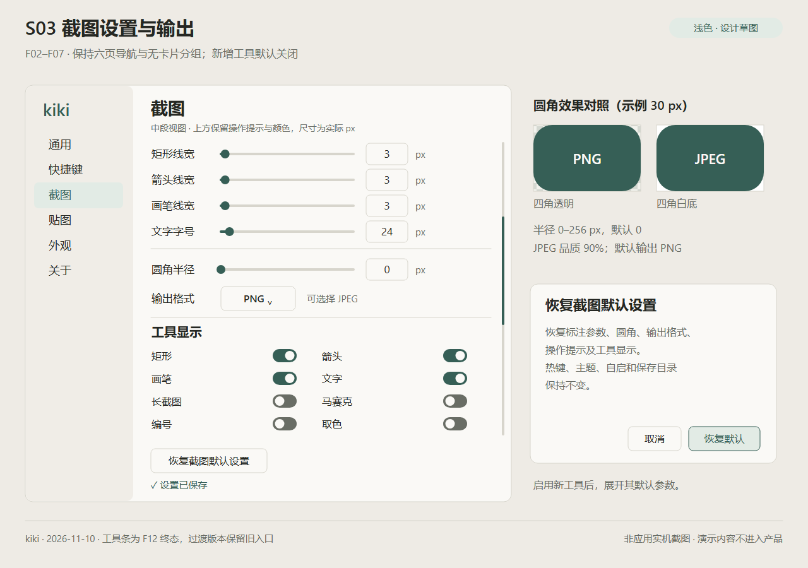
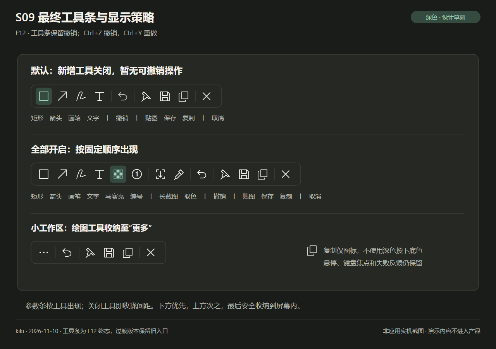

# F01–F12 已确认功能设计草图

日期：2026-11-10。依据已确认的 [功能方案](../../FEATURE_PLAN.md) 绘制，当前应用仍为 v0.2.2。这里是**设计草图，非实机截图、非运行时贴图、非功能验收证据**。简体中文标注解释目标交互，示例正文不进入产品。

每个场景提供可编辑 SVG 和 1280×900 PNG，浅色/深色共 18 张。原生实现必须绘制真实控件和命中区域；SVG/生成脚本不随应用分发，不引入 JavaScript 应用运行时。

## 功能与设计映射

| 场景 | 功能 | 浅色 PNG / SVG | 深色 PNG / SVG |
| --- | --- | --- | --- |
| S01 直接编辑与截图边缘 | F01、F03 | [PNG](s01-edit-light.png) / [SVG](s01-edit-light.svg) | [PNG](s01-edit-dark.png) / [SVG](s01-edit-dark.svg) |
| S02 连续参数与滚轮 | F02、F03，参数样式供 F08/F09 复用 | [PNG](s02-parameters-light.png) / [SVG](s02-parameters-light.svg) | [PNG](s02-parameters-dark.png) / [SVG](s02-parameters-dark.svg) |
| S03 设置、圆角、格式及恢复默认 | F02–F07，新增工具设置入口 | [PNG](s03-settings-light.png) / [SVG](s03-settings-light.svg) | [PNG](s03-settings-dark.png) / [SVG](s03-settings-dark.svg) |
| S04 可编辑矩形马赛克 | F08 | [PNG](s04-mosaic-light.png) / [SVG](s04-mosaic-light.svg) | [PNG](s04-mosaic-dark.png) / [SVG](s04-mosaic-dark.svg) |
| S05 顺序编号 | F09 | [PNG](s05-number-light.png) / [SVG](s05-number-light.svg) | [PNG](s05-number-dark.png) / [SVG](s05-number-dark.svg) |
| S06 取色与按次 Shift 切换 | F10 | [PNG](s06-picker-light.png) / [SVG](s06-picker-light.svg) | [PNG](s06-picker-dark.png) / [SVG](s06-picker-dark.svg) |
| S07 手动长截图采集 | F11 | [PNG](s07-long-capture-light.png) / [SVG](s07-long-capture-light.svg) | [PNG](s07-long-capture-dark.png) / [SVG](s07-long-capture-dark.svg) |
| S08 完成后长图编辑 | F11 | [PNG](s08-long-edit-light.png) / [SVG](s08-long-edit-light.svg) | [PNG](s08-long-edit-dark.png) / [SVG](s08-long-edit-dark.svg) |
| S09 默认、全开和小工作区工具条 | F07、F12 | [PNG](s09-toolbar-light.png) / [SVG](s09-toolbar-light.svg) | [PNG](s09-toolbar-dark.png) / [SVG](s09-toolbar-dark.svg) |

## 实施解释

- 工具条最终布局以 S09 为准。按 F12 复测反馈保留撤销按钮，重做通过 Ctrl+Y 操作。S01–S08 保留各功能的交互草图。
- 新四工具默认关闭。S04–S08 是用户已开启相应工具后的操作示例；S09 第一行才是默认显示状态，第三行展示窄屏收纳，不增加可隐藏的输出动作。
- S03 为设置页中段视图，上方原有操作提示和颜色仍保留；内容滚动、保存状态固定，开启新增工具时展开参数。右侧圆角对照使用示例 30 px，不代表把默认 0 改为 30。恢复确认框在右侧单独展开说明，不常驻设置页。
- 标注红色固定 #FF3B40，浅深强调色分别 #365F56 / #A0CEBB。底图示例仅帮助说明界面，真实捕获图像不会随应用主题重着色。
- 主工具条以 48 DIP 高度、至少 36×36 DIP 命中区落地，图片为放大评审稿，不按图片像素硬编码运行布局。
- S01 同屏展示多种对象的编辑手柄用于说明规则；实际仅当前选中对象显示控制点。文字内部编辑、边框移动、顶部手柄旋转。画笔只整笔移动，不做节点或大小手柄。
- S07 进入即清空对象、文字草稿及撤销/重做历史；没有保留旧标注的确认流程。取消结束会话，下一次普通截图。S08 是捕获停止后的完整长图静态编辑，不是将当前屏幕视口当输出。
- 失败/暂停/焦点等完整状态按功能方案及 [验收计划](../../ACCEPTANCE_PLAN.md) 实现；草图不替代输入优先级、失败恢复或资源限制规则。

## 查看与再生成

以下仅用于维护文档设计源，生成静态 SVG/PNG，不运行应用。无需 npm 安装或外部字体/图片；需要本机 Node.js 和已安装 Chrome/Edge，浏览器后台运行。

```powershell
node docs/design/next/render-sketches.cjs
# 仅重新输出 SVG：
node docs/design/next/render-sketches.cjs --svg-only
```

脚本 [render-sketches.cjs](render-sketches.cjs) 使用矢量形状与文字生成 SVG，通过本机 headless 浏览器栅格化 PNG；`KIKI_SKETCH_BROWSER` 可指定已安装的浏览器。渲染专用 `.render-profile` 只用于本任务并在正常结束后删除，失败遗留不入库。字体随本机中文字体版本可能有细小差别，更新后应查看所有场景，不能仅检查文件存在。




