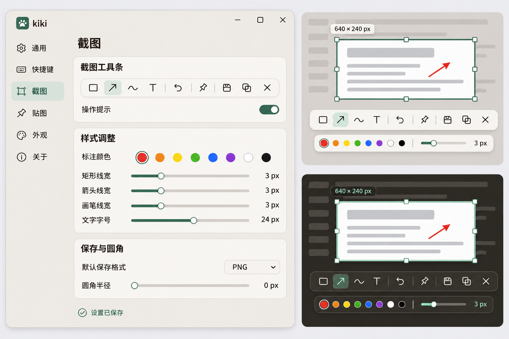
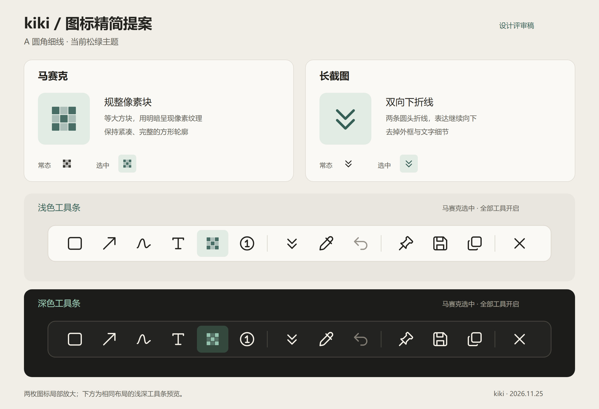

# kiki 界面与图标整体升级方案

2026-11-25。实施基线为 v1.0.24。用户已选定 **B 版分组排版 + 当前暖灰松绿主题 + A 圆角细线图标（最终像素块／双向下折线修订）**。本文件整理已选方向、实现细则及验收安排；目前已实现 v2.0.0 候选，执行状态统一记录在 [PROGRESS.md](../../PROGRESS.md)，实测范围见[升级验证](../../validation/settings/ui-upgrade-v2.0.0.md)。

## 1. 设计依据与优先级

| 组成 | 实施依据 | 使用方式 |
| --- | --- | --- |
| 设置页布局 | [B 版当前主题 PNG](b-current-theme.png) | 侧栏、页面层级、三组圆角面板、控件对齐与留白 |
| 全套截图图标 | [最终 A 版 PNG](capture-icon-a-pixels-chevrons.png) / [SVG](capture-icon-a-pixels-chevrons.svg) | 使用 SVG 中全部 `a-*` 定义，包括更多图标；两枚修订直接采用最终路径 |
| 精确颜色 | [palette.rs](../../../src/platform/windows/ui/palette.rs) | 沿用应用主题色，不从效果图取样近似颜色 |
| 功能与交互 | [视觉规范](../../DESIGN_SPEC.md)、[功能方案](../../FEATURE_PLAN.md) | 图中的示例值、缺省工具和模拟文档不覆盖已实现行为 |
| 验收 | [验收计划](../../ACCEPTANCE_PLAN.md)及本文件第 7 节 | 设计批准与应用验收分别记录 |

“B”专指界面排版，“A”专指图标系统。B 图中早期图标均由最终 A 版替换；三套图标对照稿及之前的两枚修订保留为历史，不作为实施输入。用户已确认的方向无需再次选择。下面的尺寸与实施顺序是该方向下的具体落地安排。

## 2. 统一视觉规则

| 用途 | 浅色 | 深色 |
| --- | --- | --- |
| 内容／工具条底色 | `#FAF9F6` | `#232321` |
| 侧栏／辅助底面 | `#F1EEE8` | `#2D2A26` |
| 主文字／常态图标 | `#25231F` | `#F4F0E8` |
| 次要文字 | `#625D55` | `#C7BFB4` |
| 细边框／分隔线 | `#DFDBD2` | `#49453F` |
| 松绿强调色 | `#365F56` | `#A0CEBB` |
| 选中底色 | `#E3EBE5` | `#34483E` |
| 悬停底色 | `#EEEAE4` | `#383530` |

- 暖灰窗口底面、暖白或暖炭内容面板，使用细边框区分层级。松绿用于选中、焦点、滑杆有效段和主要操作；标注默认红色继续按功能规格处理。
- 页面标题 24 DIP，分组标题 18 DIP，正文 14–16 DIP，辅助说明 12–14 DIP。使用系统 UI 字体及中文回退，文字布局按真实测量结果排列。
- 设置内容边距 24–32 DIP，分组间距 16 DIP，面板内边距 20 DIP，行高以 42 DIP 为基准；双行说明自适应增高。分组圆角 12 DIP，按钮圆角 6 DIP，1 DIP 细边框。
- 工具条高 48 DIP、圆角 10 DIP，普通按钮保持 42×36 DIP 命中范围和约 46 DIP 中心间距。图标使用 24×24 坐标网格，实际轮廓约 16–19 DIP，按视觉中心校正。
- 适度半透明只用于浮层；纯色降级与深浅主题同样清晰。首次实现复用现有原生绘制能力，无额外模糊依赖或持续装饰动画。
- 窗口初始尺寸沿用约 960×680 DIP；窄窗口保留导航和操作可达性，正文垂直滚动。真实控件与绘制背景共用布局坐标。

## 3. 六页设置与配套界面

| 页面／区域 | 升级后组织 | 关键行为 |
| --- | --- | --- |
| 通用 | 开始截图入口、启动与后台、设置文件三个信息组 | 保留有效热键、启动提示、开机启动及打开设置文件夹 |
| 快捷键 | 截图热键编辑组、固定快捷键说明组 | 冲突提示靠近输入框；保留恢复默认和中文输入焦点 |
| 截图 | 截图工具条、样式调整、保存与圆角三个面板 | 详见下文，作为首个完整落地页面 |
| 贴图 | 操作说明组、关闭全部贴图操作区 | 保留拖动、缩放、右键菜单帮助 |
| 外观 | 跟随系统、浅色、深色三张预览 | 当前选项以松绿边框和勾选体现，切换即时生效 |
| 关于 | 品牌版本、操作帮助与许可入口层级 | 沿用内嵌帮助，长文自适应换行与滚动 |
| 贴图浮层／托盘菜单 | 与截图同款图标、圆角、间距和主题反馈 | 贴图仅显示复制、保存、关闭；菜单仍执行既有动作 |
| 长截图与取色浮层 | 统一面板、文字、边框与按钮状态 | 保留尺寸、采集状态、完成／取消、预览定位和颜色信息 |

六页导航顺序仍为通用、快捷键、截图、贴图、外观、关于。导航图标按 A 的圆端、线宽和视觉重量整理，应用爪印标识沿用现有资源。各页按内容分组，不机械凑成三块面板。

截图页具体内容：

1. **截图工具条**：显示与真实工具条同源的实时预览；点击整行展开／收起工具开关，无额外下拉图标。开关使用同款图标及名称；操作提示开关保留。
2. **样式调整**：标注颜色和已启用工具的参数。标签及范围位于左侧，连续滑杆位于中间，像素读数统一右对齐。矩形、箭头、画笔、文字、马赛克及编号按现有开关显示；滑杆常驻，不新增分组折叠。
3. **保存与圆角**：PNG/JPEG 选择、圆角滑杆、真实圆角预览及格式说明。保留恢复截图默认设置入口与范围确认。

保存状态固定在内容区底部；正文滚动不遮挡它。窄窗口可以缩短滑杆并让说明换行，不能让读数、格式选择或恢复入口溢出。用户已存的参数、工具开关和主题继续读取，示意图里的 3 px／24 px 不写回用户配置。

## 4. 最终图标规范

| 图标 | 采用的形态 |
| --- | --- |
| 矩形、箭头、画笔、文字 | A 版圆角矩形、斜向箭头、连续曲线、T 字轮廓 |
| 马赛克 | 紧凑 3×3 等大实心像素块，交替两档明暗 |
| 编号 | 圆环与居中数字 1 |
| 长截图 | 两条向下的圆端折线 |
| 取色、撤销 | 滴管与回转箭头 |
| 贴图、保存、复制、取消 | 图钉、软盘、重叠方框、交叉线 |
| 更多 | 三个等距实心圆点 |

- 轮廓图标使用 24×24 网格、1.65 单位描边、圆端与圆连接。渲染与 DPI 缩放同步，不能用字符字体近似图形。
- 马赛克为已批准的填充例外。按最终 SVG，方块 5×5、步距 5.5、圆角 0.35，起点为 (4,4)，交替透明度 0.9／0.32；使用当前图标颜色合成。实现时需恢复画刷透明度，避免影响后续图标。
- 长截图仅绘制最终 SVG 的两条折线，不添加页面、箭杆、取景框或文字；悬停提示明确写“长截图”。
- 同一图标在真实工具条、设置预览、工具选择、贴图按钮中共享几何来源。导航图标按同一风格绘制，不另引入一套外部字体图标。
- SVG 为矢量设计参考，原生实现转为 Direct2D 几何和基础图元；PNG 只用于对照，不作为运行时 UI 贴图。

## 5. 工具条和控件状态

全部工具开启时顺序：

`矩形、箭头、画笔、文字、马赛克、编号 | 长截图、取色、撤销 | 贴图、保存、复制 | 取消`

原四项绘图工具默认开启，新增四工具默认关闭；关闭工具后自动收拢。撤销常驻，无历史时禁用；重做仍为 Ctrl+Y。截图主条优先放在选区下方，其次上方，最后安全收纳到当前屏幕，窄空间使用更多菜单。

| 状态 | 表现与操作 |
| --- | --- |
| 常态 | 主题前景图标，背景保持工具条底色 |
| 悬停 | 轻微主题底色反馈，显示名称和已支持的快捷键 |
| 当前工具 | 松绿图标与浅／深松绿选中底色 |
| 按下 | 复用主题按下反馈；复制沿用悬停样式，不增加深色实心底 |
| 禁用 | 降低视觉重量并禁止动作，不显示为当前工具 |
| 键盘焦点 | 清晰的松绿焦点边框；与选中状态可同时识别 |

参数条按工具出现，保留当前物理像素单位及调参行为。长截图进入时清空标注／草稿／历史、普通跨屏截图、中文 IME、撤销和失败恢复均按既有规格执行。

## 6. 实施阶段与代码入口

| 阶段 | 实施工作 | 阶段完成证据 |
| --- | --- | --- |
| U1 共享图标与控件基础 | 在 `ui/toolbar_icons.rs` 接入最终 A 几何；统一绘制状态和尺寸常量；主题继续使用 `ui/palette.rs` | 浅深真实工具条、设置预览及贴图图标一致；默认／全开／窄屏组合和命中通过 |
| U2 截图设置页 | 在 `settings/layout.rs` 为三个组计算面板范围；`settings/render.rs` 绘制背景；`settings/mod.rs` 接入实际控件位置、状态与滚动 | 默认与全工具配置、标准／窄窗口、滑杆／工具展开／恢复／持久化通过 |
| U3 六页及浮层统一 | 将同款分组与控件规则应用到其他设置页；统一导航图标、参数条、取色、长截图、贴图与菜单 | 六页浅深实拍、焦点／键盘／弹窗及编辑流程回归通过 |
| U4 整体验收与交付 | Release 构建、真实导出、ZIP 解压启动、文档和公开截图更新 | 被测提交、EXE/ZIP 哈希、验证记录、使用说明及明确的环境遗留项 |

每个可验证阶段独立本地提交并更新进度；既有功能已实现，不重做 F01–F12。布局调整不引入新的捕获／输出算法，不增加应用依赖。保持 Rust 2024、已验证工具链、Win32、Direct2D、DirectWrite 与 WIC。

本次准备阶段仅固化方案，不变更 VERSION 或创建功能完成标签。实施后的版本按实际改造规模和仓库版本规则确定，在候选构建前同步版本，验收后创建相应本地说明标签。最终交付源码、ZIP、使用说明、验证与必要的性能报告；不自动推送或发布。

## 7. 验收清单

以下全部是后续待执行项目；既有截图不是本轮实现证据。

| 编号 | 检查范围 | 通过标准 |
| --- | --- | --- |
| UI-01 | 浅／深／跟随系统 | 六页及截图、参数、贴图等浮层颜色正确，无残留旧样式或不可读状态 |
| UI-02 | 100%、125%、150%、200% 缩放；标准与约 660 DIP 窄窗口 | 图标线条、像素格、文字清晰，控件无裁切；绘制与命中重合；缺少的实机条件明确待验 |
| UI-03 | 图标与工具组合 | 默认／全开／全关／更多菜单、撤销禁用、复制按下正确；马赛克与长截图与最终图一致 |
| UI-04 | 截图设置页 | 开关即时更新预览，按工具显示参数，鼠标和键盘均可操作，滚动与底部状态不遮挡，重启后配置保持 |
| UI-05 | 六页键盘与反馈 | Tab 焦点可见、热键冲突可读、保存反馈完整、恢复取消无变更，中文输入正常 |
| UI-06 | 截图编辑与浮层 | 框选、移动、八点调整、绘图、马赛克、编号、取色、长截图进入／完成／取消、撤销／重做行为正确 |
| UI-07 | 输出与贴图 | 实际 PNG/JPEG、剪贴板粘贴及贴图保存检查尺寸、颜色、标注和圆角；无工具条／提示混入输出 |
| UI-08 | 系统与资源 | 工具条贴边与收纳安全；关闭透明效果可用；主题切换／窗口重建不泄漏图形资源；多屏等未覆盖环境单列 |
| UI-09 | 构建与交付 | 格式、严格 Clippy、默认／全特性串行测试、Release、ZIP 解压启动及版本／清单／哈希核对通过 |

运行检查沿用 README 和验收计划中的正式命令，测试加 `--test-threads=1`。布局测试重点覆盖不同配置下的控件边界和命中，不能仅比较硬编码坐标；视觉结论必须来自真实应用。

性能采样按变更影响执行。若修改重绘或资源生命周期，比较界面开关／主题切换后的资源回收和闲置状态；记录 Release 模式、机器、显示器及采样方法，不复用历史数字冒充本版结果。长截图已知漏段、HDR 及其他历史环境待验项继续在进度中保留。
