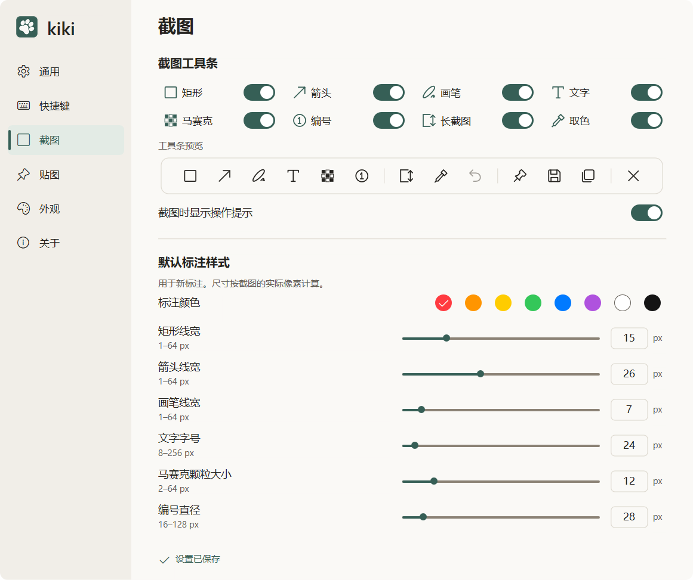

# 标注与参数

[模块索引](README.md) · [当前进度](../PROGRESS.md) · [使用说明](../USAGE.md)

矩形、箭头、画笔、文字、马赛克和顺序编号共享可编辑对象及有界撤销历史。参数采用成图物理像素，设置和截图双向同步；撤销对象操作不回滚已保存偏好。

## 设计与行为

产品规格第 5 节；视觉规范第 4、5、7a 节；F01–F03、F08、F09。

[产品规格](../PRODUCT_SPEC.md) · [视觉规范](../DESIGN_SPEC.md) · [功能方案](../FEATURE_PLAN.md)

- [02-toolbars.png](../design/02-toolbars.png)
- [next/s01-edit-light.png](../design/next/s01-edit-light.png)
- [next/s02-parameters-light.png](../design/next/s02-parameters-light.png)
- [next/s02-parameters-dark.png](../design/next/s02-parameters-dark.png)
- [next/s04-mosaic-light.png](../design/next/s04-mosaic-light.png)
- [next/s04-mosaic-dark.png](../design/next/s04-mosaic-dark.png)
- [next/s05-number-light.png](../design/next/s05-number-light.png)
- [next/s05-number-dark.png](../design/next/s05-number-dark.png)

## 开发入口

| 源码 | 职责 |
| --- | --- |
| [src/core/annotation.rs](../../src/core/annotation.rs) | 对象、命中、编辑与历史 |
| [src/core/config.rs](../../src/core/config.rs) | 参数范围与默认值 |
| [src/platform/windows/parameter_control.rs](../../src/platform/windows/parameter_control.rs) | 滑杆与数值输入 |
| [src/platform/windows/text_input.rs](../../src/platform/windows/text_input.rs) | 中文 IME 与文本编辑 |
| [src/platform/windows/annotation_render.rs](../../src/platform/windows/annotation_render.rs) | 标注绘制 |
| [src/platform/windows/composition.rs](../../src/platform/windows/composition.rs) | 最终成图合成 |

共用构建、原生诊断和资源约束见 [开发说明](../DEVELOPMENT.md)。

## 验证与记录

检查直接编辑优先级、连续手势撤销、文字重编/旋转和 IME、颗粒与覆盖范围分离、删除编号后重排。PNG/JPEG、剪贴板及贴图应使用同一几何和样式；仅看预览不算输出验收。

[F01 用例](../ACCEPTANCE_PLAN.md#f01) · [F02 用例](../ACCEPTANCE_PLAN.md#f02) · [F03 用例](../ACCEPTANCE_PLAN.md#f03) · [F08 用例](../ACCEPTANCE_PLAN.md#f08) · [F09 用例](../ACCEPTANCE_PLAN.md#f09)

- [F02-v0.4.0.md](../validation/annotation/F02-v0.4.0.md)
- [F03-v0.5.0.md](../validation/annotation/F03-v0.5.0.md)
- [F08-v0.9.0.md](../validation/annotation/F08-v0.9.0.md)
- [F09-v0.10.0.md](../validation/annotation/F09-v0.10.0.md)
- [P4.md](../validation/annotation/P4.md)
- [P4_COMPOSITION.md](../validation/annotation/P4_COMPOSITION.md)
- [P4_TEXT.md](../validation/annotation/P4_TEXT.md)
- [直接编辑与选区](../validation/capture/F01-v0.3.0.md)

报告只代表各自记录的版本和环境，当前放行及缺项见 [PROGRESS.md](../PROGRESS.md)。

## 真实界面

以上为用户提供的最新浅色截图，来源和环境限制见 [图库](../screenshots/README.md)。

相关模块：[普通截图与工具条](capture.md) · [输出与圆角](output.md) · [设置与运行入口](settings.md)
