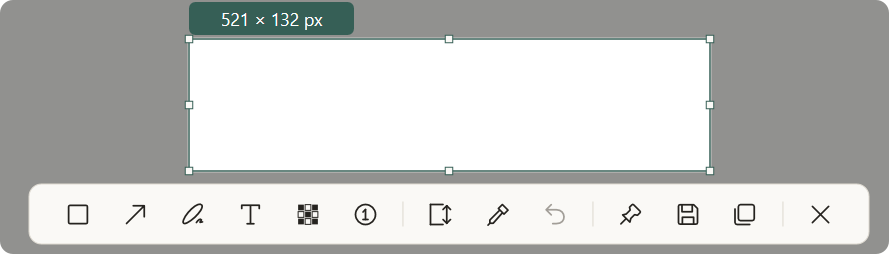

# 普通截图与工具条

[模块索引](README.md) · [当前进度](../PROGRESS.md) · [使用说明](../USAGE.md)

普通截图默认先冻结桌面，再选择区域、可见窗口或当前屏幕。此模块负责物理坐标、选区调整、窗口吸附以及工具条显示、定位和键盘焦点。

## 设计与行为

产品规格第 3、4、7 节；视觉规范第 4、5 节；F01、F07、F12。

[产品规格](../PRODUCT_SPEC.md) · [视觉规范](../DESIGN_SPEC.md) · [功能方案](../FEATURE_PLAN.md)

- [01-capture.png](../design/01-capture.png)
- [02-toolbars.png](../design/02-toolbars.png)
- [next/s01-edit-light.png](../design/next/s01-edit-light.png)
- [next/s01-edit-dark.png](../design/next/s01-edit-dark.png)
- [next/s09-toolbar-light.png](../design/next/s09-toolbar-light.png)
- [next/s09-toolbar-dark.png](../design/next/s09-toolbar-dark.png)

## 开发入口

| 源码 | 职责 |
| --- | --- |
| [src/core/geometry.rs](../../src/core/geometry.rs) | 物理坐标与边界 |
| [src/core/selection.rs](../../src/core/selection.rs) | 选区与拖动 |
| [src/core/session.rs](../../src/core/session.rs) | 会话与取消 |
| [src/platform/windows/capture.rs](../../src/platform/windows/capture.rs) | 冻结图像捕获 |
| [src/platform/windows/window_targets.rs](../../src/platform/windows/window_targets.rs) | 可见窗口识别 |
| [src/platform/windows/capture_toolbar.rs](../../src/platform/windows/capture_toolbar.rs) | 工具条动作与布局 |
| [src/platform/windows/preview.rs](../../src/platform/windows/preview.rs) | 普通截图输入路由 |

共用构建、原生诊断和资源约束见 [开发说明](../DEVELOPMENT.md)。

## 验证与记录

重点核对任意工具下整边/八点调整、选择状态、全部工具开关组合、浅深工具条、边缘/窄屏定位与最终图像无控件。真实混合 DPI、负坐标及跨屏间隙需要实机证据，模拟测试不能替代。

[F01 用例](../ACCEPTANCE_PLAN.md#f01) · [F07 用例](../ACCEPTANCE_PLAN.md#f07) · [F12 用例](../ACCEPTANCE_PLAN.md#f12)

- [F01-v0.3.0.md](../validation/capture/F01-v0.3.0.md)
- [F07-v0.8.0.md](../validation/capture/F07-v0.8.0.md)
- [F07-v0.8.1.md](../validation/capture/F07-v0.8.1.md)
- [F12-v1.0.2.md](../validation/capture/F12-v1.0.2.md)
- [P2.md](../validation/capture/P2.md)
- [P3.md](../validation/capture/P3.md)
- [UI_POLISH.md](../validation/capture/UI_POLISH.md)

报告只代表各自记录的版本和环境，当前放行及缺项见 [PROGRESS.md](../PROGRESS.md)。

## 真实界面

以上为用户提供的最新浅色截图，来源和环境限制见 [图库](../screenshots/README.md)。

相关模块：[标注与参数](annotation.md) · [长截图](long-capture.md) · [输出与圆角](output.md)
