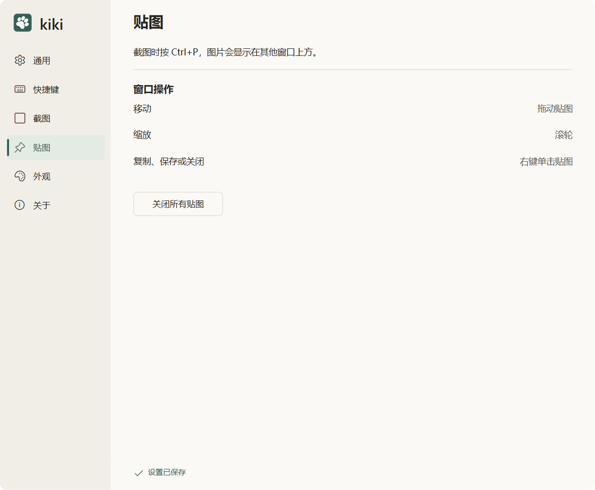

# 置顶贴图

[模块索引](README.md) · [当前进度](../PROGRESS.md) · [使用说明](../USAGE.md)

将已合成图像显示为独立置顶浮窗，可同时保留多张。拖动移动、滚轮缩放、Ctrl+0 恢复原比例、Ctrl+C 复制、Ctrl+S 保存、Esc 关闭。缩放仅改变显示，输出保持原图尺寸。

## 设计与行为

产品规格第 8 节；视觉规范第 7 节；P5。贴图不包含再次标注、透明度调节或鼠标穿透。

[产品规格](../PRODUCT_SPEC.md) · [视觉规范](../DESIGN_SPEC.md) · [功能方案](../FEATURE_PLAN.md)

- [04-pinned.png](../design/04-pinned.png)

## 开发入口

| 源码 | 职责 |
| --- | --- |
| [src/core/pinned.rs](../../src/core/pinned.rs) | 缩放与位置模型 |
| [src/platform/windows/pinned.rs](../../src/platform/windows/pinned.rs) | 窗口与操作 |
| [src/platform/windows/pinned_render.rs](../../src/platform/windows/pinned_render.rs) | 浮窗绘制 |
| [src/platform/windows/pinned_device.rs](../../src/platform/windows/pinned_device.rs) | 设备与资源 |
| [src/platform/windows/output.rs](../../src/platform/windows/output.rs) | 复制与保存 |

共用构建、原生诊断和资源约束见 [开发说明](../DEVELOPMENT.md)。

## 验证与记录

按 P5 检查多图、悬停控件、右键菜单、缩放中心、恢复原比例、关闭全部、输出原图尺寸及释放资源。最新附件是设置中的贴图说明页，不是贴图浮窗截图。

- [P5_PINNED.md](../validation/pinned/P5_PINNED.md)
- [输出与贴图综合验收](../validation/output/P5_COMPLETION.md)

报告只代表各自记录的版本和环境，当前放行及缺项见 [PROGRESS.md](../PROGRESS.md)。

## 真实界面

以上为用户提供的最新浅色截图，来源和环境限制见 [图库](../screenshots/README.md)。

相关模块：[输出与圆角](output.md) · [设置与运行入口](settings.md) · [工程、性能与交付](engineering.md)
