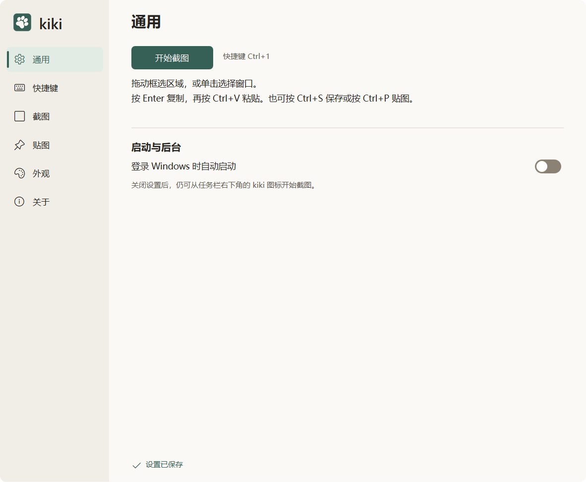

# 设置与运行入口

[模块索引](README.md) · [当前进度](../PROGRESS.md) · [使用说明](../USAGE.md)

通用、快捷键、截图、贴图、外观、关于六页设置，配合托盘入口、系统注册热键、可选开机启动、自动保存与主题切换。恢复截图默认仅作用于截图偏好，不改热键、主题、自启、保存位置及当前编辑。

## 设计与行为

产品规格第 3、9 节；视觉规范第 6 节；F06、F07 与后续设置修订。

[产品规格](../PRODUCT_SPEC.md) · [视觉规范](../DESIGN_SPEC.md) · [功能方案](../FEATURE_PLAN.md)

- [05-settings-layout.png](../design/05-settings-layout.png)
- [next/s03-settings-light.png](../design/next/s03-settings-light.png)
- [next/s03-settings-dark.png](../design/next/s03-settings-dark.png)

## 开发入口

| 源码 | 职责 |
| --- | --- |
| [src/core/config.rs](../../src/core/config.rs) | 配置、默认值与迁移 |
| [src/platform/windows/settings.rs](../../src/platform/windows/settings.rs) | 设置交互 |
| [src/platform/windows/settings_layout.rs](../../src/platform/windows/settings_layout.rs) | 布局与滚动 |
| [src/platform/windows/settings_render.rs](../../src/platform/windows/settings_render.rs) | 整帧绘制与主题 |
| [src/platform/windows/config_store.rs](../../src/platform/windows/config_store.rs) | 配置读写 |
| [src/platform/windows/preferences.rs](../../src/platform/windows/preferences.rs) | 偏好同步 |
| [src/platform/windows/hotkey.rs](../../src/platform/windows/hotkey.rs) | 系统热键注册 |
| [src/platform/windows/startup.rs](../../src/platform/windows/startup.rs) | 开机启动 |
| [src/platform/windows/runtime.rs](../../src/platform/windows/runtime.rs) | 运行入口与托盘协调 |

共用构建、原生诊断和资源约束见 [开发说明](../DEVELOPMENT.md)。

## 验证与记录

检查六页实际操作、焦点、开关、滑杆、数值输入、滚轮分工、恢复默认范围、配置失败重试与重启。快滚和拖滑块需检查过程帧，不只终态；各版闪烁失败记录继续保留。

[F06 用例](../ACCEPTANCE_PLAN.md#f06) · [F07 用例](../ACCEPTANCE_PLAN.md#f07)

- [F06-v0.7.1.md](../validation/settings/F06-v0.7.1.md)
- [P6.md](../validation/settings/P6.md)
- [settings-flicker-v1.0.7.md](../validation/settings/settings-flicker-v1.0.7.md)
- [settings-layout-v1.0.5.md](../validation/settings/settings-layout-v1.0.5.md)
- [settings-scroll-v1.0.6.md](../validation/settings/settings-scroll-v1.0.6.md)
- [settings-slider-v1.0.8.md](../validation/settings/settings-slider-v1.0.8.md)
- [settings-usability-v1.0.9.md](../validation/settings/settings-usability-v1.0.9.md)

报告只代表各自记录的版本和环境，当前放行及缺项见 [PROGRESS.md](../PROGRESS.md)。

## 真实界面

以上为用户提供的最新浅色截图，来源和环境限制见 [图库](../screenshots/README.md)。

其余面板：[快捷键](../screenshots/settings/shortcuts-light.png)、[截图](../screenshots/settings/capture-light.png)、[贴图](../screenshots/settings/pinned-light.png)、[外观](../screenshots/settings/appearance-light.png)。关于页尚未收录最新截图。

相关模块：[普通截图与工具条](capture.md) · [标注与参数](annotation.md) · [视觉资源](visuals.md)
