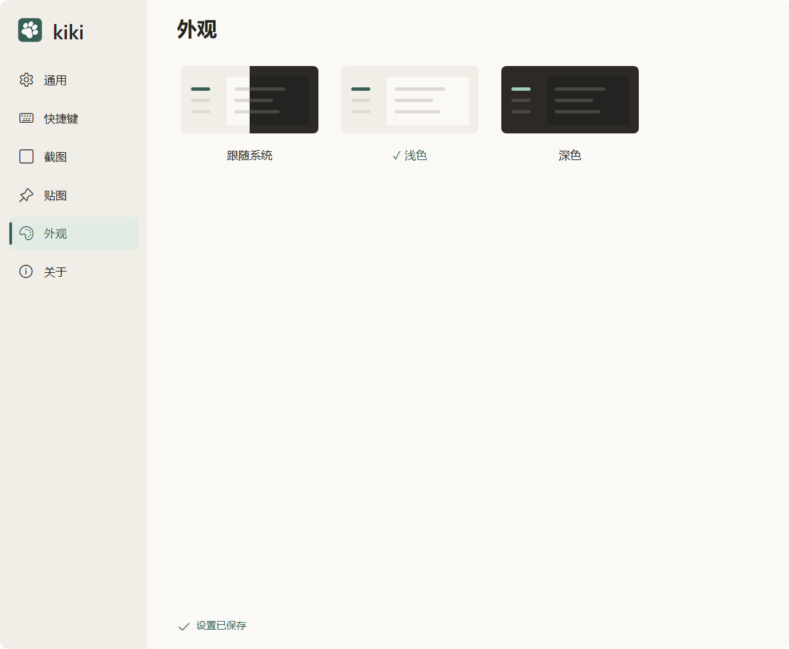

# 视觉资源

[模块索引](README.md) · [当前进度](../PROGRESS.md) · [使用说明](../USAGE.md)

统一暖灰、松绿、线性图标和 Win11 圆角。设计稿解释已批准方向，真实截图说明实现外观，两类资料分别维护。浅色强调色 #365F56，深色 #A0CEBB；03 设置稿仅作历史参考。

## 设计与行为

视觉规范为约束入口，01、02、04、05 及 next/S01–S09 为对应设计参考。后续明确决策优先于早期图中的旧名称、颜色与按钮。

[产品规格](../PRODUCT_SPEC.md) · [视觉规范](../DESIGN_SPEC.md) · [功能方案](../FEATURE_PLAN.md)

- [01-capture.png](../design/01-capture.png)
- [02-toolbars.png](../design/02-toolbars.png)
- [04-pinned.png](../design/04-pinned.png)
- [05-settings-layout.png](../design/05-settings-layout.png)
- [next/s09-toolbar-light.png](../design/next/s09-toolbar-light.png)
- [next/s09-toolbar-dark.png](../design/next/s09-toolbar-dark.png)

## 开发入口

| 源码 | 职责 |
| --- | --- |
| [src/platform/windows/ui_palette.rs](../../src/platform/windows/ui_palette.rs) | 主题颜色 |
| [src/platform/windows/toolbar_icons.rs](../../src/platform/windows/toolbar_icons.rs) | 线性工具图标 |
| [src/platform/windows/icon.rs](../../src/platform/windows/icon.rs) | 应用图标 |
| [src/platform/windows/selection_render.rs](../../src/platform/windows/selection_render.rs) | 选区绘制 |
| [src/platform/windows/settings_render.rs](../../src/platform/windows/settings_render.rs) | 设置面板绘制 |

共用构建、原生诊断和资源约束见 [开发说明](../DEVELOPMENT.md)。

## 验证与记录

真实应用视觉变更需要浅深主题、缩放、命中与最终图像检查。仅更新文档图库时记录图片来源、版本/构建/环境已知与未知项，核对原件；不从用户截图推断默认值或补写功能通过。

- [图标验证](../validation/engineering/ICONS.md)
- [界面修订](../validation/capture/UI_POLISH.md)
- [设置视觉与交互](../validation/settings/settings-usability-v1.0.9.md)

报告只代表各自记录的版本和环境，当前放行及缺项见 [PROGRESS.md](../PROGRESS.md)。

## 真实界面

以上为用户提供的最新浅色截图，来源和环境限制见 [图库](../screenshots/README.md)。

资源来源见 [图标说明](../ICONS.md)，完整设计映射见 [设计目录](../design/README.md) 和 [草图目录](../design/next/README.md)。

相关模块：[普通截图与工具条](capture.md) · [设置与运行入口](settings.md) · [工程、性能与交付](engineering.md)
