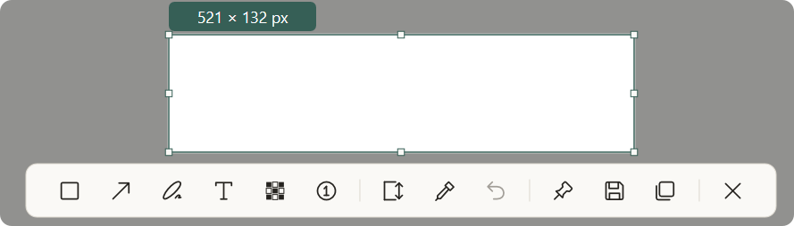
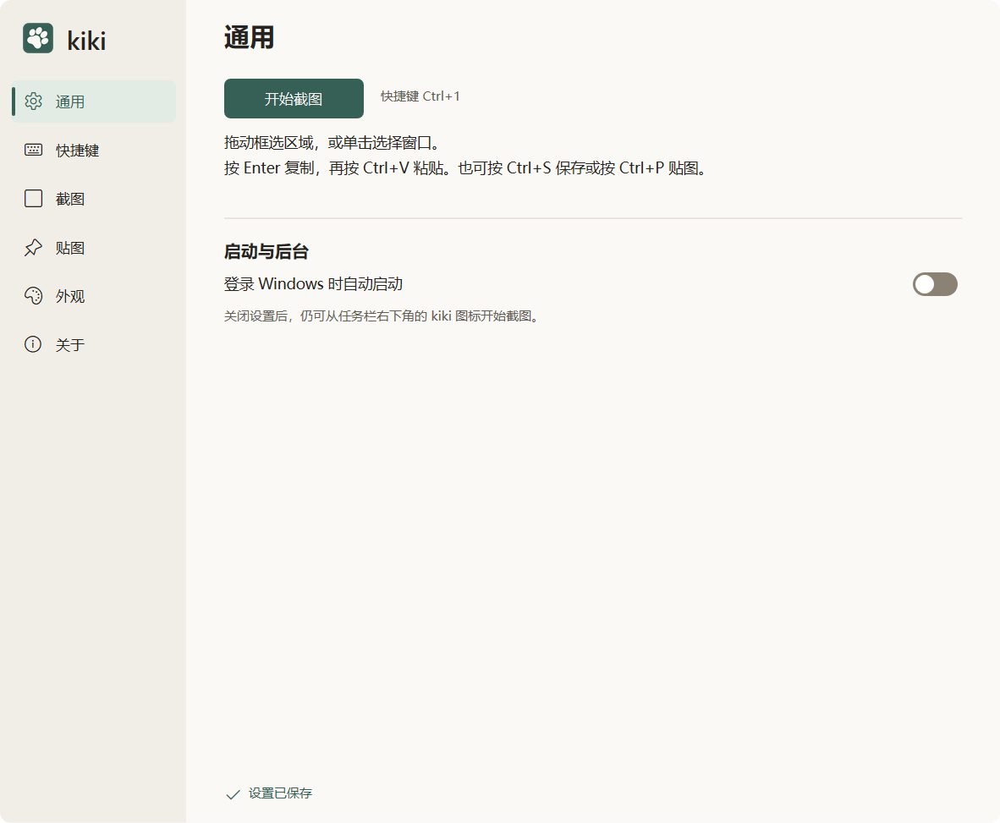
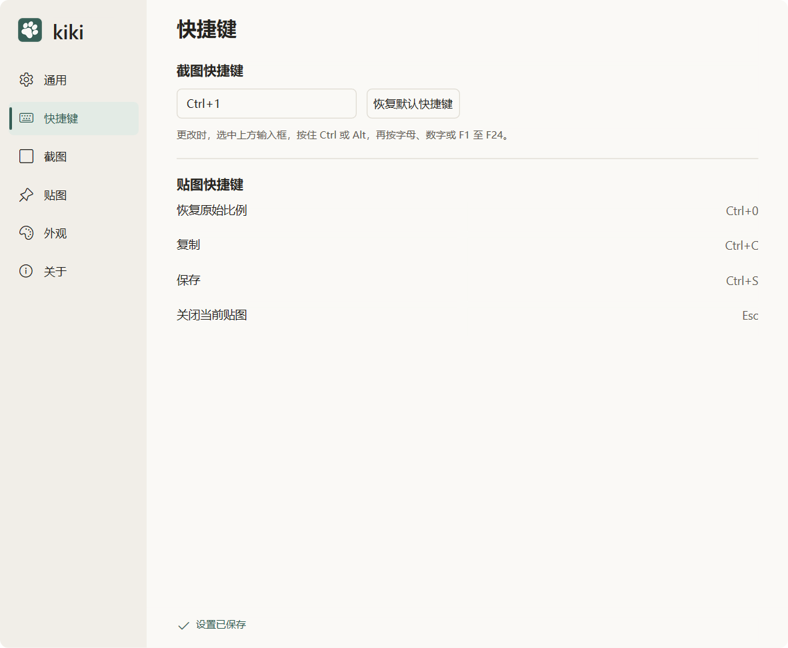
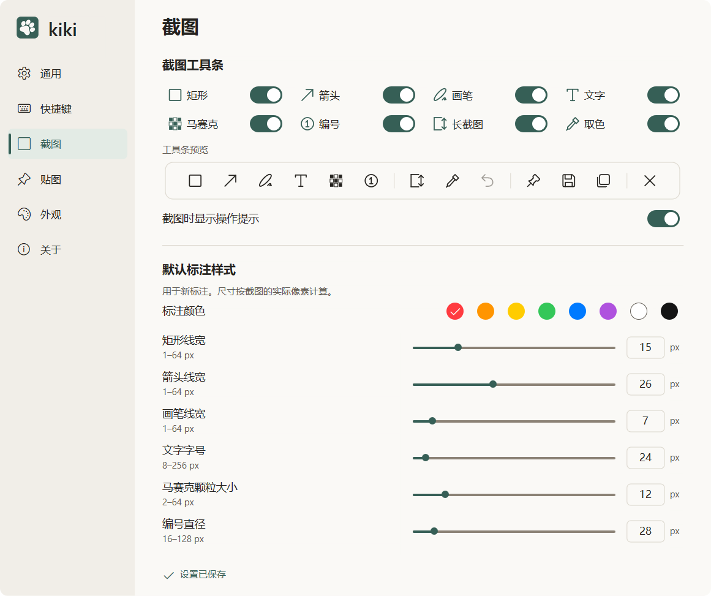
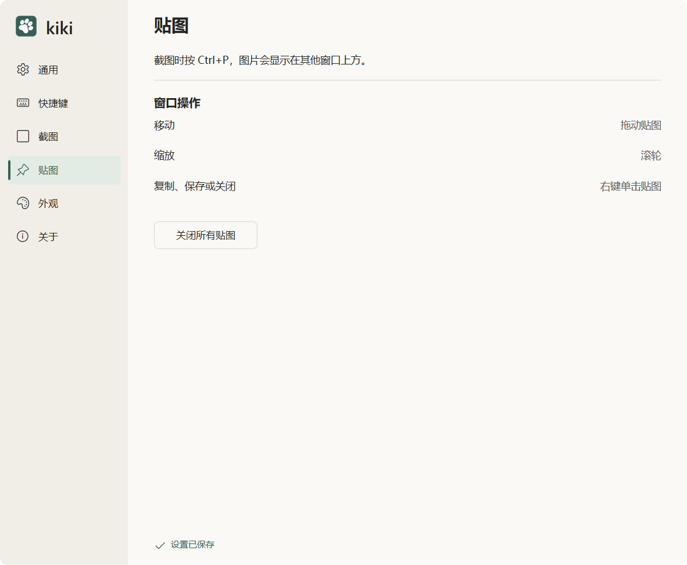
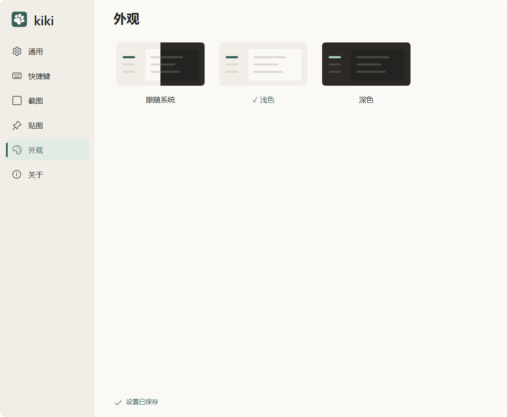

# 当前界面与功能面板

收录日期：2026-11-13。来源：用户本次提供的六张“最新版软件截图”，内容为真实软件界面，主题为浅色。收录时仓库源码为 v1.0.9；附件没有关于页、EXE 哈希、构建模式或环境元数据，不能独立确认截图二进制版本。Windows build、硬件、分辨率、显示缩放及采集方式均未提供，不套用历史报告环境。

原始 PNG 按字节复制，未缩放、裁剪或重新编码。以下 SHA-256 均与附件核对一致；像素尺寸来自 PNG 文件头。

| 内容 | 图片尺寸（px） | SHA-256 |
| --- | --- | --- |
| [截图选区与全部工具](capture/toolbar-light.png) | 889 × 254 | `e6523c9e1f70bd5814f08926bdf38dedf18ce4259dddc191582a0bdfa2f3e6e6` |
| [通用](settings/general-light.png) | 1182 × 973 | `2d26ac89c98da87884ced4e5aa627e71d0340143fa44982dc7829862a60cb23f` |
| [快捷键](settings/shortcuts-light.png) | 1182 × 973 | `592dbf68bf4814c3a60a47f31caf66d16565344acb2162fc386e830af4a2ba10` |
| [截图](settings/capture-light.png) | 1161 × 973 | `118d2e7045d1b02e6c8cb288c98db60b8fa7e80aa05c3e188d8a0daa42052119` |
| [贴图](settings/pinned-light.png) | 1182 × 973 | `1cd1a34fd1927af588ba4ca2e133b265fb87ed1f7faa463146bb2f8983b209ac` |
| [外观](settings/appearance-light.png) | 1182 × 973 | `051bd87626ba7d1e651261f532211e4a2f85b85eb35b8cdcc32033ebb2e8b335` |

图中的 Ctrl+1、线宽 15/26/7 px、全部工具开启等均为用户当前配置。默认截图热键仍为 Ctrl+Alt+A，原四绘图工具默认开，马赛克、编号、长截图和取色默认关。截图上的 521 × 132 px 是选区尺寸，不是附件文件尺寸。

## 截图与工具条

工具顺序：矩形、箭头、画笔、文字、马赛克、编号 | 长截图、取色、撤销 | 贴图、保存、复制 | 取消。此图展示全部八工具开启状态。

## 通用

## 快捷键

## 截图

此图仅覆盖截图页上部；“保存与圆角”和页尾恢复默认入口未出现在附件中，不能据此认定已移除。

## 贴图

## 外观

## 历史图与证据边界

- [2026-11-10 三张原始公开截图](archive/2026-11-10/README.md)保留在归档目录，不再作为当前界面主图。
- 旧版浅深主题实拍见 [v1.0.5](../validation/settings/settings-layout-v1.0.5.md)、[v1.0.7](../validation/settings/settings-flicker-v1.0.7.md)、[v1.0.8](../validation/settings/settings-slider-v1.0.8.md)。它们保留各自测试版本，不冒充最新截图。
- 本次未提供最新版深色工具条/面板、关于页、长截图采集、贴图浮窗及实际导出样张；本次收录不新增功能、输出或性能通过结论。
- [设计稿](../design/README.md)用于解释交互方向，与真实界面截图分开管理。
