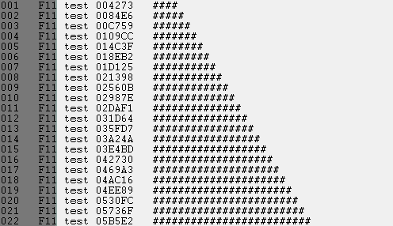
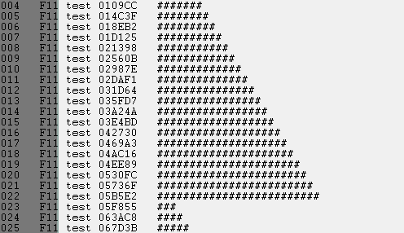
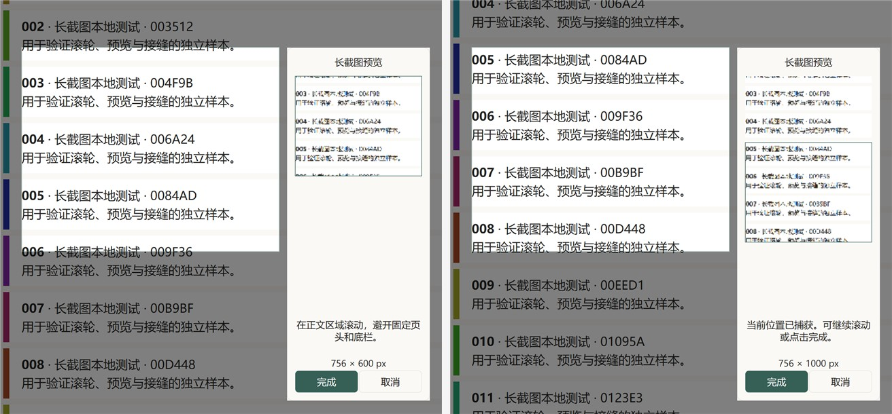

# v1.0.24 长截图实时遮罩验证

2026-11-23 在 1920 × 1080、125%、60 Hz SDR 屏复现原问题。2026-11-24 在 3420 × 2138、200%、144 Hz SDR 屏复测最终版。系统为 Windows 11 x64 build 26300.9974，处理器为 Intel Core i5-12400。Release 全特性测试程序打开真实的截图工具条和 Win32 编号文档，向工具条派发鼠标消息，向滚轮钩子提供一次向下滚动事件，通过 Windows Graphics Capture（WGC）采集滚动前后的桌面，结束后走应用的 PNG 输出流程。

## 滚动与成图

| 条件 | 观察与像素核对 |
| --- | --- |
| 修复前的普通长截图 | 拼接高度从 286 增至 325 px，框外区域的滚动前后像素仍完全相同，外围滚动断言失败。 |
| 普通长截图，浅色和深色 | 首行从 001 变为 004。框外左侧的编号带保持压暗，其滚动后像素与滚动前向上平移 39 px 的对应区域逐像素一致。框内首帧与原文档一致，完成按钮的取样颜色与当前主题一致。 |
| Shift 参考框，浅色和深色 | 以 286 px 高的参考框采集 190 px 高的原选区。WGC 可见参考框外围的暗化编号，滚动后向上平移 39 px。WGC 读取的整个参考框首帧与无遮挡原文档逐像素一致，包含原选区及上下各 48 px 的参考带。右侧预览显示 424 × 229 px。 |
| 文件输出 | 解码普通模式 424 × 325 px、参考框模式 424 × 229 px 的 PNG，首个和末个完整视口分别与滚动前、关闭截图后采到的原文档像素一致，覆盖两张 PNG 的每一行。两种主题均通过。 |

下图截自同一份测试文档。左侧编号位于遮罩下，右侧正文位于输出选区内。首次的 001 行和滚动后的 004 行均可在左栏辨认。两张实拍按同一桌面坐标裁剪。

| 滚动前 | 滚动后 |
| --- | --- |
|  |  |

完整成图仅包含右侧正文。 [普通模式输出样张](live-v1.0.24/live-output.png)

浅深色预览、参考区实拍和原始日志位于 `artifacts/validation/long-live/`，其中 `baseline` 留存修复前失败样本，`light` 和 `dark` 留存最终版成功样本。

## Edge 网页滚动

在同一台 Windows 11 机器、200% 缩放、Edge 158.0.4370.33 下打开本地编号长网页。框选 756 × 600 px 正文并点击工具条的「长截图」，向下滚动两格，按 Enter 完成后通过保存对话框导出 756 × 1000 px 的 PNG。下图左侧为滚动前，右侧为滚动后。两侧选区位置相同，框外压暗的段落与框内正文一起上移。

- 对照滚动前后各自的无遮挡网页，选区内各 453,600 个 RGB 像素全部一致。选区上方的 756 × 132 px 区域有 46,314 个像素随滚动改变。该区域每个颜色通道都符合 128/255 黑色遮罩的预期，最大误差为 1。
- 导出 PNG 中的前 600 行和后 600 行分别与滚动前、滚动后的原网页逐像素一致，两次取样覆盖整张长图。桌面原图、PNG 和对比结果保存在 `artifacts/validation/long-live/app/`。
- 独立界面测试使用实现提交 `8b89758` 的 Release 诊断构建。桌面已有 kiki 实例，测试副本使用独立的单实例互斥名称和临时设置目录；截图、拼接与输出使用同一份实现。用户 GIF 所示的 IDE 及实体混合 DPI 环境仍待复测。

## 构建与交付

- Rust 1.88.0 的格式检查、全目标全特性严格 Clippy 通过。默认和全特性串行套件各通过 87 项，各有 7 项按需运行。上述浅深主题的四次桌面验证单独使用 Release 全特性构建运行。
- 在本页记录的 200% 环境中，从派发滚轮到工具条取得增长后的预览数据，各条件采样一次。普通入口浅色 64.2 ms、深色 73.9 ms，Shift 入口浅色 156.4 ms、深色 88.5 ms。
- `dist/kiki-v1.0.24-windows-x64.zip` 已重新解压核对。包内含 `kiki.exe`、`README.txt` 和 `LICENSE.txt`，EXE 产品版本为 1.0.24，与无诊断特性的 Release 构建逐字节一致，使用说明含实时遮罩操作。
- 无参数启动解压后的正式 EXE，在已有实例运行的桌面正常从单实例入口退出，返回码为 0。当前在运的同版本 EXE 来自先前解压的目录，与最终包的哈希不同；切换构建需从托盘退出当前实例后再运行新解压的 EXE。
- ZIP SHA-256 为 `a25da8ba9d903f3966daa851d9d244af17e8a7a313035244eac7a8ea3ecbe0f7`，EXE SHA-256 为 `c4a67628bb84a01aeb7c8fd56e8551855782323b168744be3b18b1ebd3817832`。
